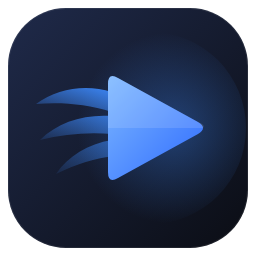

# VideoFly



Lecteur de médias (vidéo et audio) léger pour Windows, écrit en C# (WPF + [LibVLCSharp](https://github.com/videolan/libvlcsharp)).

## Fonctionnalités

- Icône dédiée (exécutable, fenêtres, barre des tâches et fichiers associés) ; sources dans `assets/icon/`.
- Interface sombre et épurée : fenêtre sans cadre Windows (barre de titre intégrée),
  vignettes aux coins arrondis, commandes en surimpression sur la vidéo qui s'effacent
  pendant la lecture et réapparaissent dès qu'on bouge la souris

- Plusieurs vidéos en même temps : chaque vidéo s'ouvre dans sa propre **vignette** (fenêtre interne)
  - déplacement par la barre de titre, redimensionnement par les bords et les coins
  - agrandir / restaurer (bouton ou double-clic), fermer
  - la vidéo s'adapte à la taille de la vignette
- Bouton lecture / pause global dans la barre de titre (Ctrl+Espace) : si une vidéo joue, tout se met en pause ;
  sinon, toutes les vignettes repartent.
- La fenêtre de VideoFly rouvre à la même place et à la même taille (ou agrandie).
- À la fermeture, VideoFly propose de garder les vidéos ouvertes : au lancement suivant, elles sont rouvertes
  à la même place, au même moment (en pause), avec leur playlist, leur volume et la relecture
  (« Ne plus demander », modifiable dans les Options).
- Sessions `.flyv` : Fichier › Enregistrer la session (Ctrl+S) sauvegarde les vidéos ouvertes, leur place, leur
  moment de lecture et la disposition ; Fichier › Ouvrir une session (ou double-clic sur le fichier .flyv) les
  rouvre, en pause, à la place des vignettes ouvertes.
- Dans chaque vignette :
  - volume jusqu'à 250 % (au-delà de 100 %, le son est amplifié) ; la molette de la souris
    sur la vignette règle son volume par pas de 5 %, avec un arrêt à 100 %
  - plein écran (bouton en haut de la vignette, F11 ou double-clic sur l'image ; Échap pour sortir) :
    la vignette occupe tout l'écran, les autres continuent en arrière-plan
  - aperçu au survol de la barre de progression : petite image et temps à l'endroit du pointeur
  - relecture automatique activée par défaut (bouton à gauche des commandes) : la vidéo, ou la playlist
    une fois terminée, recommence au début
  - lecture / pause (touche Espace pour la vignette active)
  - avance et retour rapides : chaque clic passe à x2, x4, x8, x16, puis revient à la vitesse normale
  - boutons précédent / suivant pour se déplacer dans la playlist
  - réglage du volume et coupure du son, barre de progression
- Organisation automatique des vignettes pour remplir toute la fenêtre (bouton à côté du menu,
  ou menu **Vignettes**) : les dispositions proposées dépendent du nombre de vignettes
  (ex. pour 3 : 1 à gauche + 2 à droite, 1 en haut + 2 en bas, 3 côte à côte, 3 l'une sous l'autre…).
  La disposition choisie est réappliquée à chaque ouverture, fermeture ou changement de taille de la fenêtre,
  jusqu'à ce qu'on redimensionne une vignette à la main.
  Pour choisir la place de chaque vignette : la glisser par son titre sur une autre place
  (la place visée s'éclaire, les deux vignettes s'échangent), ou clic droit sur le titre ›
  « Mettre à la place principale ». En choisissant une disposition, chaque vignette va à la place
  la plus proche de l'endroit où elle se trouve.
- Menu : **Fichier** (ouvrir une ou plusieurs vidéos, Ctrl+O ; historique ; fermer toutes les vignettes),
  **Vignettes** (dispositions, cascade) et **Options**
- À l'ouverture, la vignette s'adapte à la taille de la vidéo (désactivable dans les Options)
- **Audio** : MP3, FLAC, WAV, OGG, Opus, M4A, AAC, WMA… La vignette affiche la pochette, le titre,
  l'artiste et l'album lus dans les tags du fichier.
- **Playlists** : chaque vignette a sa playlist (bouton liste dans les commandes).
  Ajouter (+ ou glisser des fichiers dans la liste), retirer (✕, bouton corbeille ou Suppr),
  réordonner (glisser un élément ou flèches), vider, double-clic pour lire un élément.
  Lecture enchaînée automatiquement. Enregistrer / charger au format **M3U / M3U8**
  (compatible VLC, Winamp, foobar2000…). Fichier › Nouvelle playlist ou Ouvrir une playlist…
- **Historique** (Fichier › Historique) : les 20 dernières vidéos ouvertes, avec la date ou la position
  où on s'était arrêté. Un clic rouvre la vidéo dans une nouvelle vignette et reprend à cette position.
  « Effacer l'historique » le vide.
- Glisser-déposer de fichiers vidéo sur la fenêtre
- **Programme par défaut** : Options › « Définir par défaut… » déclare VideoFly auprès de Windows
  (pour l'utilisateur courant, sans droits administrateur) et ouvre les réglages Windows où il suffit
  de le choisir. Ensuite, un double-clic sur une vidéo l'ouvre dans VideoFly ; si VideoFly est déjà
  ouvert, la vidéo s'ajoute dans une nouvelle vignette de la même fenêtre.
  Si on déplace le dossier de VideoFly, il suffit de le relancer une fois pour mettre à jour le chemin.

Les réglages et l'historique sont enregistrés dans `%AppData%\VideoFly\settings.json`.

## Compilation

Prérequis : [.NET 8 SDK](https://dotnet.microsoft.com/download/dotnet/8.0).

```
dotnet build -c Release
```

## Compilation automatique

À chaque merge / push sur `main`, GitHub Actions compile le projet et crée une **Release**
(version `v0.10.N`, N = numéro de compilation) avec le zip de l'exécutable Windows x64 autonome
(pas besoin d'installer .NET). Elle est dans la section **Releases** du dépôt.

Sur chaque pull request, le projet est seulement compilé ; l'exécutable est disponible
dans l'onglet **Actions**, artefact `VideoFly-win-x64`.
